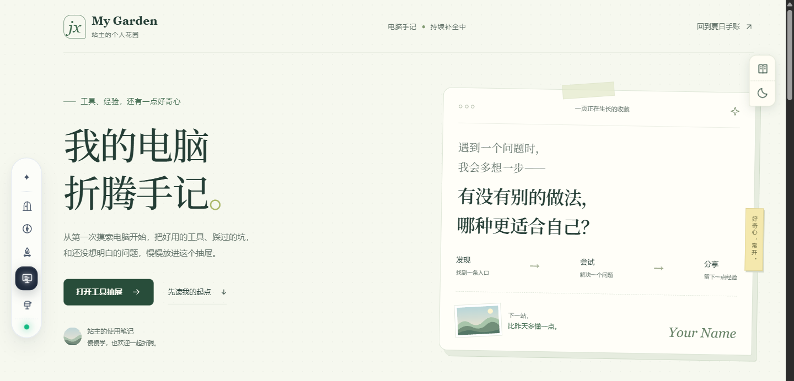
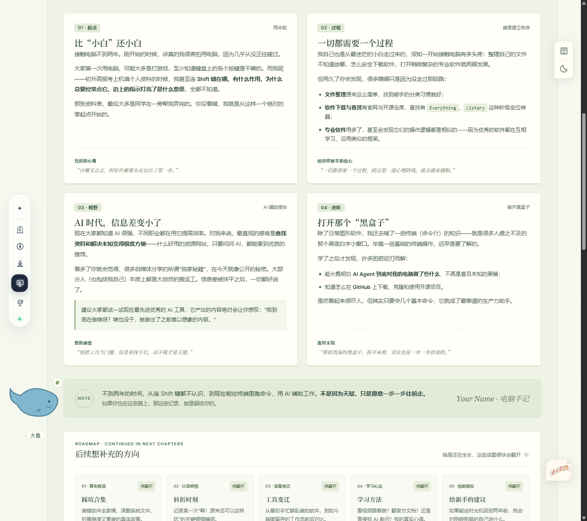

<div align="center">
  <h1>Summer Garden</h1>
  <p><strong>夏日手账风的开源个人网站模板</strong></p>
  <p>把喜欢的音乐、读过的书、走过的路，慢慢收进自己的小花园。</p>
  <p>
    <a href="#页面预览">看看页面</a> ·
    <a href="#快速开始">快速开始</a> ·
    <a href="docs/SETUP.md">定制与部署</a> ·
    <a href="https://github.com/Starlight-jiaxing/summer-garden-open-template/issues">反馈与交流</a>
  </p>
</div>

---

**Summer Garden** 是一个可以改成你自己网站的个人空间模板。从夏日站台出发，写一段自我介绍，收藏音乐、游戏、书籍和照片，也留一页记录学习与折腾的过程。

如果你想搭建个人主页、整理兴趣收藏，或从一个完整的小项目开始学习网页制作，可以先把它运行起来，再一点点换成自己的故事。

## 页面预览



<p align="center"><sub>模板预览 · 电脑手记</sub></p>

<details>
<summary>展开看看手账里的经历卡片</summary>



</details>

## 这座小花园里有什么

| 页面 | 可以放些什么 |
| --- | --- |
| **夏日站台** | 用一页有仪式感的入口，邀请访客走进你的世界 |
| **个人主页** | 自我介绍、生活片段，以及想让别人认识的你 |
| **兴趣营地** | 喜欢的音乐、游戏、书籍和照片，各有自己的角落 |
| **电脑手记** | 学习经历、工具收藏、踩过的坑，还有下一步想做的事 |
| **留言墙** | 留下问候、回复访客，让个人网站也能有来有往 |

页面里还藏着音乐播放器、相册浏览、页间过渡和一只陪你逛花园的小鲸鱼。布局兼顾电脑与手机，文字、图片和样式都可以继续修改。

前端使用 **HTML、CSS 和 JavaScript**，配套后端使用 **Python 标准库**。本地运行不需要安装 npm 依赖或执行打包命令。

## 快速开始

先安装 **Python 3.10 或更新版本**，然后[下载源码 ZIP](https://github.com/Starlight-jiaxing/summer-garden-open-template/archive/refs/heads/main.zip) 并解压。也可以使用 Git：

```bash
git clone https://github.com/Starlight-jiaxing/summer-garden-open-template.git
cd summer-garden-open-template
python server.py
```

使用 ZIP 下载时，在解压后的项目文件夹里运行 `python server.py`；Windows 用户也可以直接双击 **`start-site.cmd`**。

启动后，在浏览器打开 **[http://127.0.0.1:8765/](http://127.0.0.1:8765/)**，就能开始逛这座花园。留言等功能需要保持 Python 服务运行。

## 改成你的网站

可以从三个小地方开始：换上你的名字，写一段介绍，再放入第一张照片。其余内容，等你有空时慢慢补齐。

| 想修改的内容 | 从这里开始 |
| --- | --- |
| 站点名称与站主昵称 | [`js/site-config.js`](js/site-config.js) |
| 页面文字、经历与工具卡片 | [`index.html`](index.html) 和 [`html/`](html/) |
| 图片与相册 | [`img/`](img/) 和 [`js/photo-gallery.js`](js/photo-gallery.js) |
| 曲目与背景音乐 | [`js/main.js`](js/main.js)、[`js/site-audio.js`](js/site-audio.js) 和 [`audio/`](audio/) |
| 配色、排版与页面样式 | [`css/`](css/) |

项目附带可替换的示例图片和一段短音频，方便先体验页面。更换素材、设置留言管理密码和部署网站的步骤，都放在 **[定制与部署指南](docs/SETUP.md)** 中。

## 部署你的小花园

- **展示页面**：可以使用静态托管，展示介绍、兴趣、手记和前端交互。
- **使用完整留言功能**：需要一台能够持续运行 `server.py` 的服务器，提供留言和管理接口。

具体配置见[部署说明](docs/SETUP.md#部署到公网)。

## 交流与贡献

发现问题、有新的想法，欢迎[提交 Issue](https://github.com/Starlight-jiaxing/summer-garden-open-template/issues)。修复问题、改进文档或完善页面，也欢迎提交 Pull Request。

如果你用它搭建了自己的网站，欢迎来分享你的版本。

## 许可与致谢

项目采用 **[MIT License](LICENSE)**，欢迎使用、修改和分发，请保留相应的许可声明。

示例素材与第三方代码说明见 [ASSETS.md](ASSETS.md)；小鲸鱼交互代码的作者与许可见 [whale-widget.txt](licenses/whale-widget.txt)。感谢开源作者们的分享，也期待这座小花园在不同的人手里长出新的样子。
